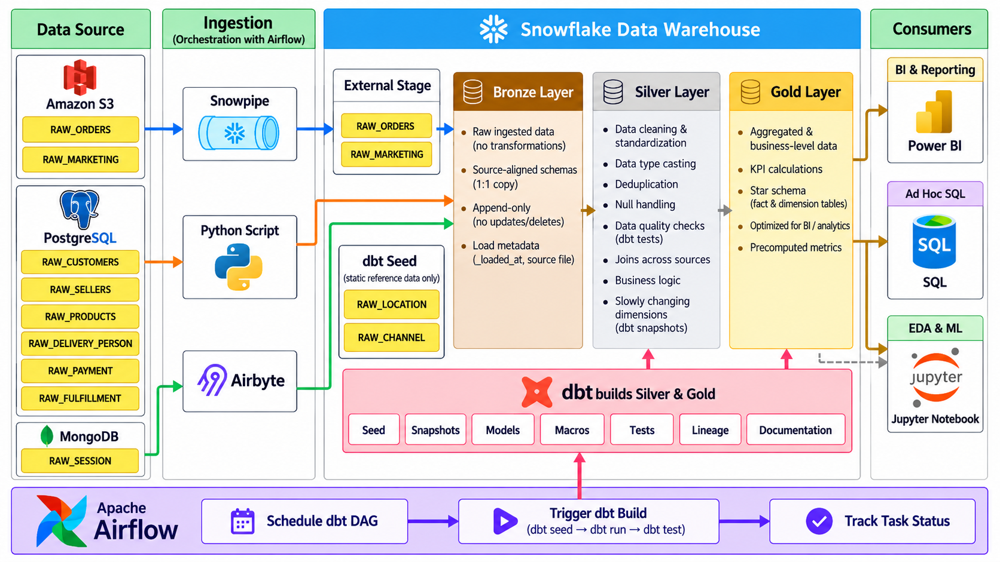
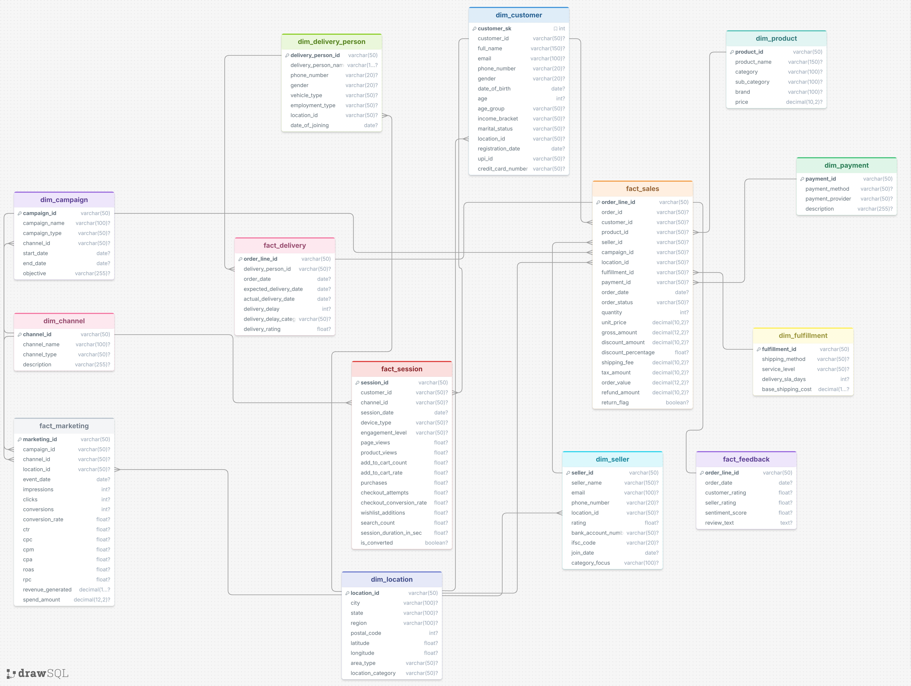
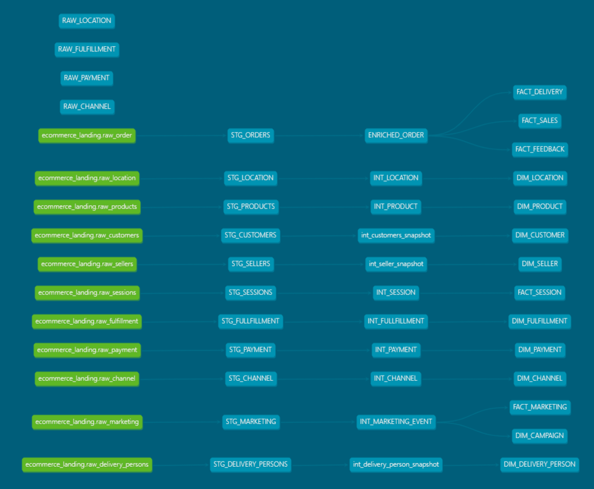

# End-To-End E-commerce Analytics Platform Using Medallion Architecture

An automated, tested ELT platform that brings 11 source tables from 3 source systems into Snowflake, models them with dbt (Bronze, Silver, Gold), and serves them to Power BI, SQL, and Jupyter.

## Project at a Glance

| | |
|---|---|
| **Sources** | 11 tables from 3 systems: AWS S3, PostgreSQL, MongoDB |
| **Ingestion** | Snowpipe (S3), Python + Prefect (PostgreSQL), Airbyte (MongoDB), dbt Seeds (lookup tables) |
| **Warehouse** | Snowflake, Medallion Architecture (Bronze, Silver, Gold) |
| **dbt project** | 11 staging models, 8 intermediate models, 3 SCD Type 2 snapshots, 5 fact tables, 9 dimension tables, 21 macros |
| **Data quality** | 254 dbt tests (213 generic, 41 singular) across staging, intermediate, and Gold |
| **Orchestration** | Prefect (PostgreSQL ingestion) and Apache Airflow (scheduled dbt runs) |
| **Consumption** | Power BI dashboard (8 pages), SQL analysis, Jupyter EDA |

---

## Business Problem

E-commerce businesses generate data across dozens of siloed systems: order management, customer CRM, marketing platforms, delivery operations, and session tracking. Without a unified data platform, teams run into problems like these:

- **No single source of truth.** Marketing, operations, and finance each work from different numbers.
- **Slow insights.** Reports take days to put together by hand from disconnected systems.
- **Little understanding of customers.** Behaviour, lifetime value, and churn signals stay hidden unless the data is joined.
- **Wasted marketing spend.** You can't measure campaign ROI without linking spend to real conversions and revenue.
- **Operational blind spots.** Delivery SLA breaches and fulfilment failures go unnoticed until they turn into bigger problems.

This project fixes that with a centralised, automated, analytics ready data platform. Raw data reaches the Bronze layer within minutes through Snowpipe, and the Silver and Gold layers refresh on a daily dbt schedule.

---

## Project Goals

| # | Goal | Outcome |
|---|------|---------|
| 1 | Bring all e-commerce data sources into one warehouse | Snowflake as the central platform |
| 2 | Automate ingestion from S3, PostgreSQL, and MongoDB | Snowpipe, Python with Prefect, and Airbyte |
| 3 | Improve data quality step by step with Medallion Architecture | Bronze, Silver, and Gold layers |
| 4 | Build a governed, tested transformation layer | dbt models, snapshots, macros, 254 tests, and documentation |
| 5 | Produce analytics ready datasets in the Gold layer | Star schema fact and dimension tables |
| 6 | Run the pipeline on a schedule | Airflow DAG for dbt, Prefect flow for PostgreSQL ingestion |
| 7 | Surface KPIs in a self serve BI dashboard | Power BI `ECOMMERCE.pbix` |
| 8 | Enable ad hoc SQL analysis and EDA | SQL summaries and Jupyter notebooks |

---

## Project Architecture



**How the data flows:**

1. **Raw data lands** in AWS S3 (orders, marketing), PostgreSQL (customers, sellers, products, delivery persons), and MongoDB (sessions).
2. **Snowpipe** reacts to new S3 files automatically, loads them through a Snowflake External Stage, and runs `COPY INTO` to fill the Bronze tables.
3. **A Python script orchestrated by Prefect** extracts the PostgreSQL tables and loads them into the Bronze layer with a `_loaded_at` timestamp.
4. **Airbyte** syncs MongoDB session documents into the Bronze layer on a schedule.
5. **dbt Seeds** load the static lookup tables (location, channel, payment, fulfilment) into Bronze.
6. **dbt staging and intermediate models** rename, cast, clean, deduplicate, and enrich the data. dbt snapshots track history for customers, sellers, and delivery persons (SCD Type 2).
7. **dbt Gold models** build the star schema and calculate the KPIs.
8. **Airflow** runs the dbt commands every day, in the right order, and runs all the tests.
9. **Power BI** connects to the Gold layer for dashboards, while Jupyter notebooks and SQL queries use Gold for EDA and ad hoc analysis.

---

## Tools & Technologies

| Category | Tools / Technologies | Purpose |
|---|---|---|
| **Architecture** | Modern ELT, Medallion Architecture, cloud data platform | Scalable, layered processing |
| **Data Sources** | AWS S3, PostgreSQL, MongoDB | Where the raw data lives |
| **Ingestion** | Snowpipe, Airbyte, Python (pandas, psycopg2, snowflake-connector-python) | Automated ingestion into Bronze |
| **Landing Zone** | Snowflake External Stage | Landing zone for files from S3 |
| **Data Warehouse** | Snowflake | Centralised cloud data warehouse |
| **Transformation** | dbt Core (installed with pip), SQL, Jinja | Models, snapshots, macros, and business logic |
| **Orchestration** | Prefect, Apache Airflow | Prefect runs the PostgreSQL ingestion flow, Airflow schedules the dbt commands |
| **Data Quality** | dbt generic and singular tests | Validation and integrity checks |
| **Data Governance** | dbt lineage and docs, Snowflake masking policies | Lineage tracking, documentation, and protection of sensitive columns |
| **Analytics & BI** | Power BI, SQL | Dashboards and ad hoc analysis |
| **EDA** | Jupyter Notebook, pandas, NumPy, matplotlib, seaborn | Exploratory data analysis |
| **Environment** | uv, Docker (for local Airflow) | Dependency management and local runtime |

---

## Raw Layer Data (Source Tables Overview)

| Category | Table Name | Key Fields / Attributes | Description |
|---|---|---|---|
| **Customer Data** | RAW_CUSTOMERS | CUSTOMER_ID, FIRST_NAME, LAST_NAME, EMAIL, PHONE_NUMBER, GENDER, DATE_OF_BIRTH, LOCATION_ID | Customer demographic and personal information |
| **Order Data** | RAW_ORDER | ORDER_LINE_ID, ORDER_ID, CUSTOMER_ID, PRODUCT_ID, QUANTITY, ORDER_DATE, ORDER_STATUS, PAYMENT_ID | Transactional order line data |
| **Product Data** | RAW_PRODUCTS | PRODUCT_ID, PRODUCT_NAME, CATEGORY, SUB_CATEGORY, LIST_PRICE, BRAND | Product catalogue and pricing details |
| **Seller Data** | RAW_SELLERS | SELLER_ID, SELLER_NAME, EMAIL, PHONE_NUMBER, LOCATION_ID, RATING | Seller profiles and performance data |
| **Session Data** | RAW_SESSIONS | SESSION_ID, CUSTOMER_ID, CHANNEL_ID, PAGE_VIEWS, PRODUCT_VIEWS, ADD_TO_CART_COUNT, PURCHASES | User interaction and behaviour tracking |
| **Marketing Data** | RAW_MARKETING | MARKETING_ID, CAMPAIGN_ID, CHANNEL_ID, CLICKS, IMPRESSIONS, CONVERSIONS, REVENUE_GENERATED | Marketing campaign performance metrics |
| **Payment Data** | RAW_PAYMENT | PAYMENT_ID, PAYMENT_METHOD, PAYMENT_PROVIDER | Payment methods and providers |
| **Fulfilment Data** | RAW_FULFILLMENT | FULFILLMENT_ID, SHIPPING_METHOD, SERVICE_LEVEL, DELIVERY_SLA_DAYS, BASE_SHIPPING_COST | Shipping and fulfilment details |
| **Delivery Data** | RAW_DELIVERY_PERSONS | DELIVERY_PERSON_ID, DELIVERY_PERSON_NAME, PHONE_NUMBER, VEHICLE_TYPE, LOCATION_ID | Delivery personnel information |
| **Location Data** | RAW_LOCATION | LOCATION_ID, CITY, STATE, REGION, LATITUDE, LONGITUDE | Geographical and regional mapping data |
| **Channel Data** | RAW_CHANNEL | CHANNEL_ID, CHANNEL_NAME, CHANNEL_TYPE | Sales and marketing channel classification |

---

## Medallion Layers

### Bronze Layer: Raw Ingestion Zone

The Bronze layer is the landing zone. Data arrives as it exists in the source, with no business logic, no filtering, and no renaming. The schema mirrors the source column for column.

| Source | Ingestion method | How Bronze is loaded |
|---|---|---|
| S3 (orders, marketing) | Snowpipe auto ingest with `COPY INTO` | Append only. New files add new rows. |
| PostgreSQL (customers, sellers, products, delivery persons) | Python script orchestrated by Prefect | Full refresh. The table is truncated and reloaded, and every row gets a `_loaded_at` timestamp. |
| MongoDB (sessions) | Airbyte | Scheduled sync |
| Lookup tables (location, channel, payment, fulfilment) | dbt Seeds | Reloaded from CSV files in version control |

History for customers, sellers, and delivery persons is not kept in Bronze, because that load is a full refresh. It is kept one layer up: the staging models for these tables append every load using `_loaded_at`, and dbt snapshots turn the changes into SCD Type 2 dimensions.

### Silver Layer: Cleansed and Conformed Zone

This is where **data quality is enforced**. Raw data is cleaned, standardised, and made safe for analytics. The main steps are:

- **Type casting:** strings to dates (`TRY_TO_DATE`), decimals to proper numeric types
- **Standardisation:** `UPPER` and `TRIM` on text fields, gender code mapping, age buckets
- **Deduplication:** one row per order line with `ROW_NUMBER` window functions
- **Business logic:** gross amount, discount, tax, order value, refund amount, delivery delay, return flag, and sentiment category, all defined once as macros
- **SCD Type 2:** tracking historical changes to customer, seller, and delivery person records with dbt snapshots

### Gold Layer: Analytics Ready Zone

The Gold layer is the **business intelligence layer**. Data is modelled as a star schema, so Power BI, SQL analysts, and data scientists all read from the same clean fact and dimension tables.

### Fact Tables

| Fact Table | Purpose |
|---|---|
| `FACT_SALES` | Transactional sales and order level performance metrics |
| `FACT_SESSION` | Customer behaviour on the website and app |
| `FACT_MARKETING` | Campaign performance, conversions, and marketing ROI |
| `FACT_DELIVERY` | Delivery performance, SLA compliance, and logistics efficiency |
| `FACT_FEEDBACK` | Customer feedback, ratings, and sentiment metrics |

### Dimension Tables

| Dimension Table | Purpose |
|---|---|
| `DIM_CUSTOMER` | Customer demographic and profile information (current version) |
| `DIM_PRODUCT` | Product catalogue, pricing, and category details |
| `DIM_SELLER` | Seller profile and performance attributes (current version) |
| `DIM_LOCATION` | Geographic and regional mapping information |
| `DIM_CHANNEL` | Sales and marketing channel classification |
| `DIM_CAMPAIGN` | Marketing campaign metadata and tracking |
| `DIM_PAYMENT` | Payment methods and providers |
| `DIM_FULFILLMENT` | Shipping methods, SLA, and fulfilment information |
| `DIM_DELIVERY_PERSON` | Delivery personnel information (current version) |

The schema supports these analytical areas: sales analytics, marketing performance, customer behaviour, delivery and logistics monitoring, and customer feedback and sentiment.

### Entity Relationship Diagram



---

## Repository Structure

```
.
├── Airflow/                         # Airflow DAG that schedules the dbt commands, plus setup guide
├── ecomerce_dbt/                    # dbt project (models, seeds, snapshots, macros, tests)
├── Snowflake/                       # Snowflake setup SQL
├── Masking Policy in Snowflake/     # Snowflake masking policies for sensitive columns
├── Order Summery/                   # Ad hoc SQL: orders
├── Marketing Summery/               # Ad hoc SQL: marketing
├── Session Summery/                 # Ad hoc SQL: sessions
├── Delivery Summery/                # Ad hoc SQL: delivery
├── Feedback Summery/                # Ad hoc SQL: feedback
├── EDA/                             # Jupyter notebooks
├── Fig/                             # Diagrams and screenshots
├── ECOMMERCE.pbix                   # Power BI report
├── pyproject.toml, uv.lock          # Python dependencies (uv)
└── README.md
```

---

## dbt Project

dbt is the **transformation engine** of this platform. All business logic lives in version controlled SQL.

### Project Components

```
ecomerce_dbt/
├── models/
│   ├── source/
│   │   └── source.yml                -- source definitions and freshness checks
│   │
│   ├── staging/                      -- 1:1 with Bronze: renaming, type casting, incremental loading
│   │   ├── STG_CHANNEL.sql
│   │   ├── STG_CUSTOMERS.sql
│   │   ├── STG_DELIVERY_PERSONS.sql
│   │   ├── STG_FULLFILLMENT.sql
│   │   ├── STG_LOCATION.sql
│   │   ├── STG_MARKETING.sql
│   │   ├── STG_ORDERS.sql
│   │   ├── STG_PAYMENT.sql
│   │   ├── STG_PRODUCTS.sql
│   │   ├── STG_SELLERS.sql
│   │   ├── STG_SESSIONS.sql
│   │   └── STG.yml
│   │
│   ├── intermediate/                 -- Silver: cleaned, deduplicated, enriched
│   │   ├── ENRICHED_ORDER.sql        -- deduplicated order lines with financial metrics, delay, and return flag
│   │   ├── INT_CHANNEL.sql
│   │   ├── INT_FULLFILLMENT.sql
│   │   ├── INT_LOCATION.sql
│   │   ├── INT_MARKETING_EVENT.sql
│   │   ├── INT_PAYMENT.sql
│   │   ├── INT_PRODUCT.sql
│   │   ├── INT_SESSION.sql
│   │   └── one .yml file per model
│   │
│   └── mart/                         -- Gold: star schema, BI ready
│       ├── Dim/                      -- 9 dimension tables + DIM.yml
│       └── Fact/                     -- 5 fact tables + one .yml file per fact
│
├── seeds/                            -- static lookup CSV files
├── snapshots/                        -- SCD Type 2 snapshots (customers, sellers, delivery persons)
├── macros/                           -- reusable Jinja SQL
└── tests/                            -- singular tests (staging, intermediate, dimensions, facts)
```

### Seeds

Seeds load **static lookup tables** from CSV files in version control straight into the Bronze layer, so no ingestion pipeline is needed:

| Seed File | Target Table | Contents |
|---|---|---|
| `RAW_LOCATION.csv` | `RAW_LOCATION` | City, state, region, and latitude/longitude mappings |
| `RAW_CHANNEL.csv` | `RAW_CHANNEL` | Channel names and type classifications |
| `RAW_PAYMENT.csv` | `RAW_PAYMENT` | Payment methods and provider names |
| `RAW_FULFILLMENT.csv` | `RAW_FULFILLMENT` | Shipping methods, SLA days, and base costs |

### Macros

The project has **21 reusable Jinja SQL macros**. Every marketing metric, financial calculation, and classification rule is defined once and reused across the Intermediate and Gold layers:

| Macro | Purpose |
|---|---|
| `calculate_gross_amount` | Gross revenue: `quantity x unit price` |
| `calculate_net_amount` | Net revenue after discounts and refunds |
| `calculate_discount_amount` | Discount value applied to an order |
| `calculate_refund_amount` | Refund amount calculation |
| `calculate_tax_amount` | Tax calculation after discount |
| `calculate_order_value` | Final order line value including tax and shipping |
| `calculate_ctr` | Click through rate: `clicks / impressions` |
| `calculate_cvr` | Conversion rate: `conversions / clicks` |
| `calculate_cpa` | Cost per acquisition |
| `calculate_cpc` | Cost per click |
| `calculate_cpm` | Cost per mille (1,000 impressions) |
| `calculate_roas` | Return on ad spend: `revenue / spend` |
| `calculate_rpc` | Revenue per click |
| `calculate_delay` | Delivery delay in days: actual against expected delivery date |
| `calculate_age` | Customer age from date of birth |
| `age_category` | Age bucket classification |
| `gender_map` | Gender code standardisation |
| `delivery_delay_category` | Delay severity classification |
| `return_flag` | Flag for returned orders |
| `sentiment_category` | Feedback sentiment classification (Positive / Neutral / Negative) |
| `generate_schema_name` | Dynamic Snowflake schema resolution for each environment |

### Snapshots (SCD Type 2)

dbt snapshots keep the full history of changes for customers, sellers, and delivery persons. The Gold dimensions `DIM_CUSTOMER`, `DIM_SELLER`, and `DIM_DELIVERY_PERSON` read the current version of each record (`dbt_valid_to IS NULL`).

### Tests

Data quality is tested at every layer. The tests are part of the project and run on every scheduled run.

| Layer | Generic tests | Singular tests | Total |
|---|---|---|---|
| Staging | 52 | 7 | 59 |
| Intermediate | 85 | 12 | 97 |
| Gold: dimensions | 28 | 6 | 34 |
| Gold: facts | 48 | 16 | 64 |
| **Total** | **213** | **41** | **254** |

**Generic tests:**

- `unique` and `not_null` on every primary key, and on the `_loaded_at` column that drives incremental loads
- `relationships`: foreign keys resolve to valid parent records, from facts to dimensions and from intermediate models to each other
- `accepted_values`: statuses, payment methods, channels, and categories match the expected values
- `dbt_utils.accepted_range`: ratings from 0 to 5, sentiment from -1 to 1, prices above 0, and valid coordinates
- `dbt_utils.unique_combination_of_columns`: `(id, _loaded_at)` is unique in the staging tables that keep history

**Singular tests** check business rules that a single column cannot express:

- **Reconciliation:** gross amount equals quantity times price, order value equals gross minus discount plus tax plus shipping, and ROAS and CPC match the raw measures
- **Cross-table consistency:** every order line in `FACT_SALES` also exists in `FACT_DELIVERY` and `FACT_FEEDBACK`, with the same order date
- **Pipeline health:** intermediate models stay in sync with staging, and no `_loaded_at` value lies in the future
- **Domain rules:** delivery dates are not before the order date, ratings are in range, IFSC and PIN code formats are valid, and payment methods match their providers

Tests that depend on business assumptions use `severity: warn`. They show a warning but do not stop the pipeline. All other tests fail the run.

```bash
dbt test --store-failures   # runs every test and saves the failing rows in Snowflake
```

### Lineage & Documentation

dbt generates a column level lineage graph and a searchable documentation site:

```bash
dbt docs generate
dbt docs serve --port 8081   # port 8081 because Airflow uses 8080
```

Every model, column, test, and source is documented through the `.yml` files.



---

## Orchestration

**Prefect** runs the PostgreSQL ingestion. The flow loops over the four PostgreSQL tables, with 2 retries and a 30 second wait for each table. For every table it reads the data with pandas, adds `_loaded_at`, truncates the Snowflake table, and loads the rows with `write_pandas`.

**Airflow** schedules the dbt commands in the `ecommerce_dbt_pipeline` DAG, which runs daily:

```
dbt deps -> dbt seed -> dbt run --select 'STG_*' -> dbt snapshot -> dbt run --exclude 'STG_*' -> dbt test --store-failures
```

Staging runs first and the snapshot second, so the Silver and Gold layers never lag one run behind the SCD Type 2 snapshots.

Snowpipe and Airbyte run on their own triggers and are not part of the Airflow DAG. See `Airflow/SETUP.md` for running Airflow locally with the Astro CLI.

## How to Run

```bash
uv sync                                  # install Python dependencies
# create a .env file with your PostgreSQL and Snowflake credentials

cd ecomerce_dbt
dbt deps
dbt seed
dbt run --select 'STG_*'
dbt snapshot
dbt run --exclude 'STG_*'
dbt test --store-failures
```

---

## Data Governance & Security

- **Masking policies:** Snowflake masking policies (see `Masking Policy in Snowflake/`) protect sensitive columns such as card numbers, UPI IDs, and bank account numbers.
- **No secrets in the repository:** credentials are read from environment variables.
- **Documentation and lineage:** generated by dbt from the model files.

---

## KPI Metrics

The Gold layer supports the following business KPIs, which Power BI and SQL analysts use directly:

### Revenue & Orders

| KPI | Definition |
|---|---|
| **Gross Revenue** | SUM(quantity x unit price) |
| **Average Order Value (AOV)** | Gross Revenue / Total Orders |
| **Monthly Revenue Growth** | Month over month revenue change (%) |
| **Revenue by Category** | Revenue grouped by product category |
| **Revenue by Region** | Revenue grouped by customer region |

### Customer Metrics

| KPI | Definition |
|---|---|
| **Customer Lifetime Value (CLV)** | Total revenue per customer across all orders |
| **Customer Acquisition Rate** | New customers per month |
| **Repeat Purchase Rate** | Percentage of customers with 2 or more orders |
| **Churn Rate** | Percentage of customers with no order in the last 90 days |
| **Customer Age Distribution** | Cohort breakdown by age bucket |

### Marketing & Channel

| KPI | Definition |
|---|---|
| **Click-Through Rate (CTR)** | Clicks / Impressions |
| **Conversion Rate** | Conversions / Clicks |
| **Return on Ad Spend (ROAS)** | Revenue / Marketing Spend |
| **Cost per Conversion** | Total Spend / Conversions |
| **Revenue by Channel** | Revenue attributed to each marketing channel |

### Session & Funnel

| KPI | Definition |
|---|---|
| **Add-to-Cart Rate** | ADD_TO_CART_COUNT / PRODUCT_VIEWS |
| **Checkout Conversion Rate** | PURCHASES / CHECKOUT_ATTEMPTS |
| **Page Views per Session** | AVG(PAGE_VIEWS) |
| **Sessions by Channel** | Session count grouped by channel |

### Delivery & Fulfilment

| KPI | Definition |
|---|---|
| **On-Time Delivery Rate** | Orders delivered within SLA / Total delivered |
| **Average Delivery Days** | AVG(actual delivery days) |
| **SLA Breach Rate** | Orders exceeding DELIVERY_SLA_DAYS |
| **Delivery Cost per Order** | Total shipping cost / Orders shipped |

---

## SQL Analysis

The `* Summery/` folders hold the SQL scripts written for ad hoc business questions:

```
Order Summery/          -> Revenue by period, order status breakdown, top products
Marketing Summery/      -> Campaign ROI, channel attribution, ROAS by campaign
Session Summery/        -> Funnel conversion rates, channel session quality
Delivery Summery/       -> SLA compliance, delay analysis, delivery person ranking
Feedback Summery/       -> Sentiment scoring, rating distribution, seller feedback
```

---

## Power BI Dashboard

The `ECOMMERCE.pbix` file connects to the Snowflake Gold layer and gives an executive dashboard with these pages:

| Dashboard Page | Key Visuals | Gold Tables Used |
|---|---|---|
| **Executive Overview** | Total revenue, AOV, order count, monthly trend | `FACT_SALES`, `DIM_CUSTOMER` |
| **Customer Analytics** | CLV distribution, repeat rate, churn, regional map | `DIM_CUSTOMER`, `DIM_LOCATION`, `FACT_SALES` |
| **Product Performance** | Category and sub category revenue, top products, brand ranking | `DIM_PRODUCT`, `FACT_SALES` |
| **Marketing & Channels** | CTR, ROAS, conversion funnel, campaign comparison | `FACT_MARKETING`, `DIM_CAMPAIGN`, `DIM_CHANNEL` |
| **Session Funnel** | Funnel from page views to product views, add to cart, and purchase | `FACT_SESSION`, `DIM_CHANNEL` |
| **Delivery Operations** | On time rate, SLA breaches, delivery person performance | `FACT_DELIVERY`, `DIM_DELIVERY_PERSON`, `DIM_FULFILLMENT` |
| **Seller Performance** | Seller ratings, order volume, revenue contribution | `DIM_SELLER`, `FACT_SALES` |
| **Customer Feedback** | Sentiment distribution, ratings by product and seller | `FACT_FEEDBACK`, `DIM_PRODUCT`, `DIM_SELLER` |

---

## Exploratory Data Analysis

The `EDA/` folder holds Jupyter notebooks that explore the Gold layer:

```
EDA/
├── 01_order_eda.ipynb        # Order volume trends, status distribution, revenue patterns
├── 02_delivery_eda.ipynb     # SLA compliance, delivery time distribution
├── 03_feedback_eda.ipynb     # Customer ratings, sentiment analysis, review trends
├── 04_session_eda.ipynb      # Funnel visualisation, channel performance, drop off rates
└── 05_marketing_eda.ipynb    # CTR, ROAS, campaign ROI analysis
```

---

## Key Design Decisions

- **One ingestion tool per source type.** Snowpipe suits files that land in S3 and need event driven loading. A Python script gives full control over the PostgreSQL tables. Airbyte handles the MongoDB connector and its schema.
- **Static lookup data as dbt seeds.** Location, channel, payment, and fulfilment data change rarely, so CSV files in version control are simpler than a pipeline.
- **History is kept in staging for changing records.** The PostgreSQL load is a full refresh, so the staging models for customers, sellers, and delivery persons append every load. Snapshots then track the changes as SCD Type 2.
- **Incremental models for large tables.** Orders, marketing, and sessions only process new rows on each run.
- **Business logic lives in macros.** Each metric is defined once, so the same formula is used in every model.
- **Tests at every layer.** Problems are caught in staging before they reach Gold, and tests that rely on assumptions warn instead of stopping the pipeline.
- **Split orchestration.** Prefect handles the Python ingestion flow with retries. Airflow only schedules the dbt commands, so each tool has one clear job.

## Future Improvements

- Use `_loaded_at` in the incremental filters of the intermediate models so late arriving and updated records are always picked up
- Run `dbt build` in GitHub Actions on every pull request
- Use Astronomer Cosmos so each dbt model shows as its own task in Airflow
- Build churn, CLV, and delivery delay models with scikit-learn on top of Gold features

---

## Learning Outcomes

- **Medallion Architecture:** knowing what each layer is for and where each kind of transformation belongs
- **Snowflake:** External Stages, Snowpipe auto ingest, masking policies, and clustering
- **dbt in depth:** models, seeds, macros, snapshots, incremental materialisation, tests, lineage, and documentation
- **ELT across several sources:** combining event based loading (Snowpipe), connectors (Airbyte), and custom code (Python with Prefect) in one design
- **Star schema modelling:** designing fact and dimension tables for query performance and flexibility
- **SCD Type 2:** preserving dimensional history with dbt snapshots
- **Data quality as code:** 254 tests across every layer, including reconciliation checks between tables
- **Orchestration:** Prefect flows with retries and an Airflow DAG with ordered dbt tasks
- **Analytics engineering mindset:** bridging data engineering (pipelines) and data analysis (business logic in SQL)